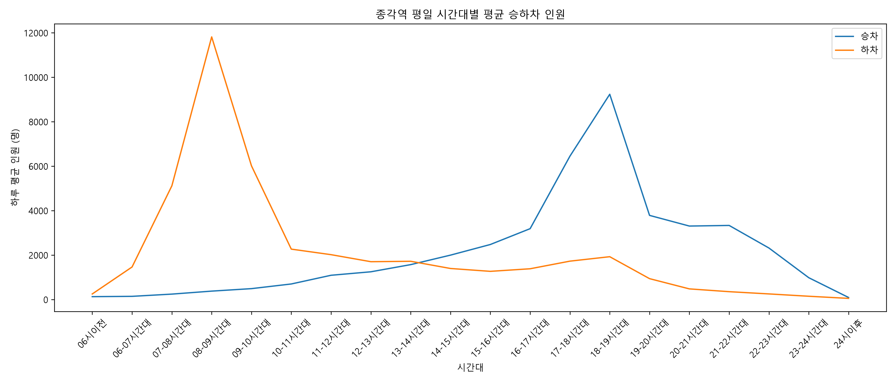
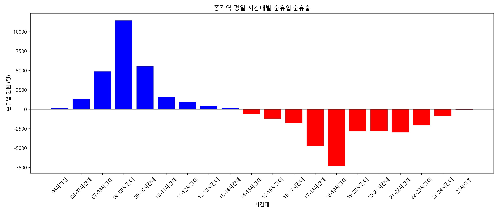
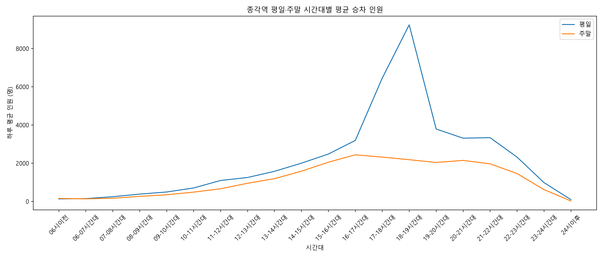
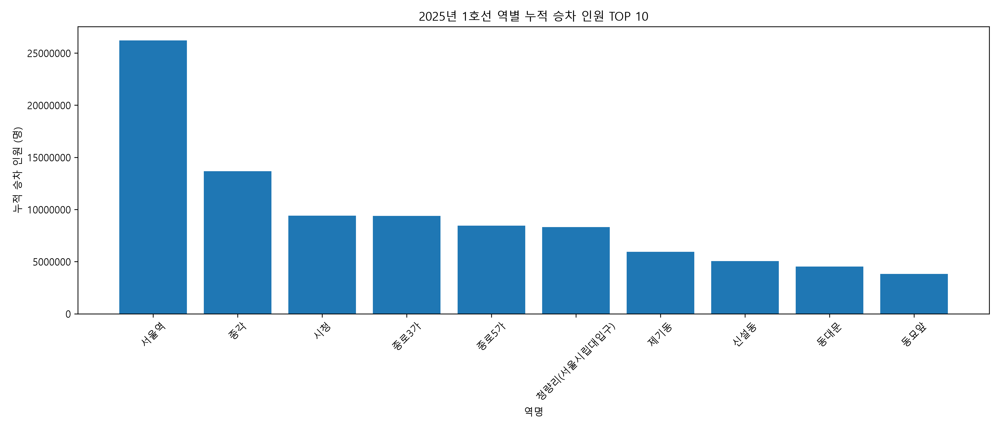
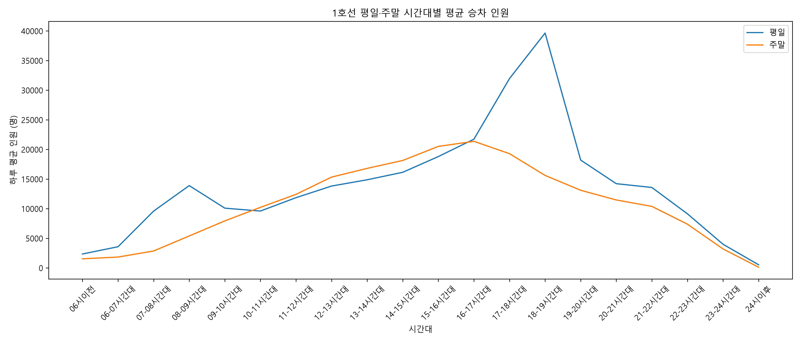
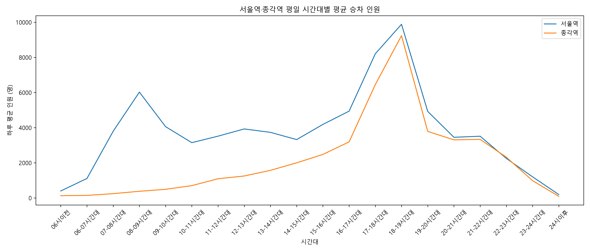

# 서울 지하철 승하차 데이터 분석

Python과 Pandas를 활용하여 2025년 서울 지하철 승하차 데이터를 분석하고, 시간대별 이용 패턴과 역별 승객 흐름을 시각화한 프로젝트입니다.

## 1. 프로젝트 개요

**분석 목적**

서울 지하철 이용 데이터를 바탕으로 다음 질문에 답하고자 했습니다.

- 평일과 주말의 지하철 이용 패턴은 어떻게 다른가?
- 종각역의 출퇴근 시간대 승차·하차 인원은 어떤 특징을 보이는가?
- 서울역과 종각역의 시간대별 승차 패턴은 어떻게 다른가?
- 1호선에서 누적 승차 인원이 많은 역은 어디인가?

**사용 기술:** Python, Pandas, Matplotlib

**데이터:** 서울교통공사 역별·일별·시간대별 승하차 인원 데이터 (2025년)

**분석 데이터 규모:** 199,424행 × 26열

## 2. 프로젝트 구조

```text
subway-analysis/
├── data/
├── src/
│   ├── data_loader.py
│   ├── analysis.py
│   ├── visualization.py
│   └── main.py
├── results/
├── README.md
└── .gitignore
```

- `data_loader.py`: CSV 파일 로딩 및 날짜 자료형 변환
- `analysis.py`: 데이터 필터링, 평균 계산, 역별 집계, 순유입·순유출 분석
- `visualization.py`: 분석 결과 시각화 및 그래프 저장
- `main.py`: 전체 분석 실행

## 3. 분석 방법

1. CSV 파일을 Pandas DataFrame으로 불러오고 날짜 자료형을 변환했습니다.
2. 호선, 역명, 승하차 구분, 요일 조건으로 데이터를 필터링했습니다.
3. 시간대별 승객 수를 집계하고 날짜 수로 나누어 하루 평균 인원을 계산했습니다.
4. 평일·주말 차이, 승하차 차이, 역별 누적 인원을 비교했습니다.
5. Matplotlib으로 결과를 시각화했습니다.

## 4. 주요 분석 결과

### 4.1 종각역의 출퇴근 시간대 특징



종각역의 평일 승하차 인원을 분석한 결과, 오전에는 하차 인원이, 저녁에는 승차 인원이 크게 증가하는 패턴이 나타났습니다.

- 오전 08~09시: 하루 평균 하차 인원 약 **11,817명**
- 저녁 18~19시: 하루 평균 승차 인원 약 **9,236명**

이는 종각역 주변 업무지구의 통근 수요와 관련이 있을 가능성을 보여줍니다. 다만 승하차 데이터만으로 개별 승객의 이동 목적을 확정할 수는 없습니다.

### 4.2 종각역의 시간대별 순유입·순유출



시간대별 하차 인원에서 승차 인원을 뺀 값을 순유입 지표로 정의했습니다.

- 양수: 하차 인원이 승차 인원보다 많은 시간대
- 음수: 승차 인원이 하차 인원보다 많은 시간대

분석 결과, 오전에는 순유입이 크게 나타났으며 저녁에는 순유출이 두드러졌습니다.

### 4.3 평일과 주말의 승차 인원 차이



종각역의 평일 최대 승차 시간대는 18~19시, 주말 최대 승차 시간대는 16~17시였습니다.

특히 18~19시에는 평일 승차 인원이 주말보다 하루 평균 약 **7,055명** 많았으며, 주말 승차 인원은 평일 대비 약 **76.4% 적었습니다.**

이를 통해 종각역의 저녁 시간대 승차 수요가 평일에 집중되는 특징을 확인했습니다.

### 4.4 1호선 역별 누적 승차 인원



2025년 데이터에서 1호선의 역별 누적 승차 인원을 비교한 결과, 서울역이 가장 높은 값을 기록했습니다.

| 순위 | 역명 | 누적 승차 인원 |
|---|---|---:|
| 1 | 서울역 | 26,223,782명 |
| 2 | 종각 | 13,673,549명 |
| 3 | 시청 | 9,417,582명 |
| 4 | 종로3가 | 9,391,308명 |
| 5 | 종로5가 | 8,450,646명 |

서울역의 누적 승차 인원은 종각역의 약 1.92배였습니다.

해당 결과는 분석 데이터에 포함된 **1호선 승차 인원 기준**이며, 서울역의 모든 노선을 합산한 수치는 아닙니다.

## 5. 추가 시각화

### 1호선 평일·주말 승차 패턴



### 서울역과 종각역의 평일 승차 패턴



## 6. 분석 한계

- 평일은 월~금, 주말은 토~일로 구분했으며 법정 공휴일과 대체공휴일은 별도로 반영하지 않았습니다.
- 승하차 인원만으로 승객의 실제 이동 목적을 확인할 수 없습니다.
- 순유입·순유출은 역의 승하차 인원 차이로 계산한 지표이며, 실제 지역 체류 인구의 증감을 직접 측정한 것은 아닙니다.
- 역별 누적 승차 인원은 분석 대상 데이터의 호선 구분을 기준으로 집계했습니다.

## 7. 실행 방법

Python 환경에서 다음 라이브러리를 설치합니다.

```bash
pip install pandas matplotlib
```

프로젝트 최상위 폴더에서 다음 명령어를 실행합니다.

```bash
python src/main.py
```

분석 결과는 터미널에 출력되며, 그래프는 `results/` 폴더에 PNG 파일로 저장됩니다.

원본 CSV 데이터는 `data/` 폴더에 배치해야 합니다.

필요한 파일명:

`서울교통공사_역별 일별 시간대별 승하차인원_20251231.csv`

## 8. 프로젝트를 통해 학습한 내용

- Pandas를 활용한 데이터 필터링 및 집계
- 날짜 자료형 변환과 평일·주말 조건 처리
- 시간대별 평균과 비율 계산
- Matplotlib을 활용한 데이터 시각화
- 데이터 분석 결과의 해석 및 한계 검토
- 기능별 Python 모듈 분리를 통한 코드 구조 개선

## 9. 향후 개선 방향

- 공휴일 정보를 반영한 평일·휴일 비교
- 추가 호선 및 역으로 분석 범위 확대
- 시간대별 혼잡 특성 비교
- 데이터 품질 검증 및 자동화된 테스트 추가
